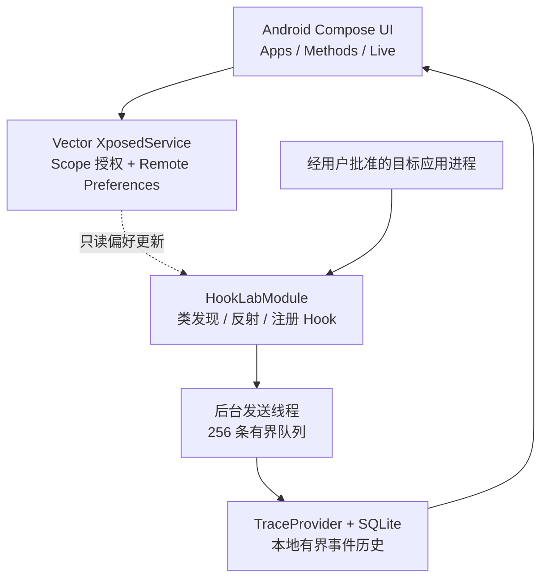
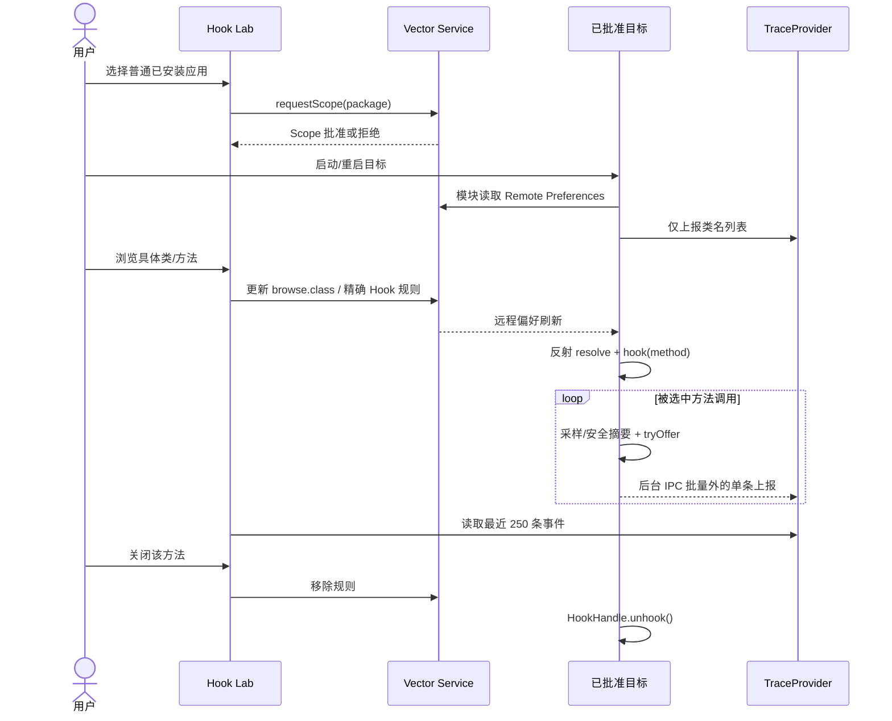

# Android Hook Lab — M2 Mobile 软件设计（v0.4）

> 日期：2026-10-20。单 APK 设计；不使用 Demo 或 PC 作为主控制面。图示为目标实现的逻辑结构，真机兼容性必须实测。

## 1. 总体分层架构



- **Apps 层**：读取具备 Launcher 的普通应用，不尝试自动获取系统级敏感应用的作用域。
- **控制层**：在 Hook Lab App 中使用 `io.github.libxposed:service:102.0.0`。Scope 请求需要 Vector 的授权回调；远程偏好由框架服务提供，跨 UID 不直接共享私有文件。
- **数据层**：目标模块只向 `dev.smallfish.hooklab.trace` 发送白名单字段的调用元数据；TraceProvider 每次检查 Binder UID 是否来自用户当前选中包名；本地数据库只有 Hook Lab App UID 可以查询。
- **注入层**：`io.github.libxposed:api:102.0.0` 的 `onPackageReady` 初始化，模块仅运行于 Vector 实际批准的 Scope，拒绝系统与自身 App。

## 2. 组件与目录

| 组件 | 目录 | 职责 |
|---|---|---|
| Compose 控制台 | `apps/android/HookLabHome.kt` | 应用选择、授权确认、规则开关与 Live UI |
| Xposed 服务连接 | `apps/android/HookLabApp.java` | Scope Request、Remote Preferences |
| 数据网关 | `apps/android/storage/TraceProvider.java` | 调用者验证、类/方法索引及 SQLite 事件 |
| 规则协议 | `libs/protocol/RuleWire.java` | 精确方法签名、作用域、数量与字符验证 |
| 模块引擎 | `engines/vector/HookLabModule.java` | 目标内部 DEX 扫描、HookHandle 安装/卸载、非阻塞采集 |

已删除 Demo Sample、固定 Hook 入口、电脑端 Frida Agent 与离线导入工具，避免代码与产品目标不一致。

## 3. 规则生命周期



动态 Hook 在目标进程的后台线程中执行，每次远程规则有变化时进行集合差异计算；未被选中的方法不注册 Hook。规则变更期间正在运行的 Hook 调用可能完成后才退出。

## 4. 规则协议

- 框架 Remote Preferences 组名：`hooklab.rules.v2`。
- `selected_target`：用户当前选中的单个包名。
- `rules.<package>`：最多 12 行精确签名，形如 `com.example.app.Foo#bar(int,java.lang.String)`。
- `browse.<package>`：需要在目标进程中反射的方法类名。

`RuleWire` 校验包名、类归属、方法标识符、重载参数类型及大小；不接受表达式、Shell 命令或通配符。字符串未经过脚本解释，不提供远程代码执行。

## 5. 类发现与方法 Hook

- 获取当前目标 APK `sourceDir` 及最多 11 个 Split 路径，在目标端通过 `dalvik.system.DexFile` 搜索本包类名，每次最多上报 100 条。
- 界面选择类后，使用目标 ClassLoader `Class.forName(name, false, loader)` 和 `getDeclaredMethods()` 获取方法重载。
- 由明确签名解析重载参数类型并 `getDeclaredMethod`，随后 libxposed `hook(...).intercept(...)`。
- `HookHandle` 保存在目标进程内，规则取消或目标不再是 `selected_target` 时调用 `unhook()`。
- 反射获取不到的类/方法或 Hook 失败时记录至 Vector 日志，不会显示虚假成功。
- 只能声明 Java 层方法，不能保证 Native 调用、内联方法、特殊系统进程或动态 ClassLoader 场景。

## 6. 采集线程与私密数据

```text
Hook callback (原始业务线程)
  └── elapsedRealtimeNanos + safe primitive summary + queue.offer
        └── background collector
              └── ContentResolver.call() on authorized local URI
                    └── TraceProvider / SQLite
                          └── Compose Live 列表
```

- callback 不跨进程 Binder、不访问磁盘；有界队列满时丢弃，绝不反压阻塞业务线程。
- 字符串只记录长度，复杂对象只记录类名，不隐式调用对象 `toString()`。
- TraceProvider 强制请求包 = 当前 UI 选中包，且调用者 UID 包集合包含此包；外部读取者必须为 Hook Lab 自身 UID。
- 目标进程可以伪造其自身 UID 的诊断消息，因此 EventProvider 信息不能当作强身份审计。
- SQLite 周期截断历史至最近约 1500 条，UI 只读取 250 条。
- 默认没有网络监听、Root Shell 或任意脚本执行路径。

## 7. 风险与验证

| 风险 | 应对 |
|---|---|
| Vector 未连接、未授予 Scope | 不启用未批准目标；UI 显示离线 |
| Framework Remote Preferences 不兼容 | 提示服务/规则失败；待实际 Vector 版本验证 |
| DEX 多、内存占用大 | 类列表上限 100；下一版分页/过滤 |
| Hook 重入或异常导致 APP 崩溃 | Hook 回调异常保护、最小修改原则，默认仅观察 |
| 跨 UID 假冒事件 | 选中包名/调用者 UID 校验、限制事件格式/长度；明确诊断数据非可信证据 |
| 采集频率过高 | 有界队列及 SQLite 上限；后续增加显式采样和 dropped 仪表 |
| 目标切换后旧规则留存 | 比较 `selected_target`，注销旧 HookHandle 和清空队列 |
| framework 动态 API 差异 | CI 编译 + RMX3350 真机单方法回归作为正式发布门槛 |

## 8. 验收

1. 构建只有一个 APK；目标应用完全来自手机已安装应用列表。
2. Vector Scope 请求可在手机完成；没有 PC/ADB。
3. 目标重启后报告真实 DEX 类和方法重载。
4. 开启目标方法、触发调用、Live 收到真实事件；关闭后不再出现新事件。
5. 目标切换或无授权时拒绝跨应用数据；不会注入系统关键进程。
6. 异常返回行为与未 Hook 时一致；高频测试不致卡死。
7. Root/Vector 实际兼容性通过设备现场验证，不能仅凭 CI 宣称通过。
