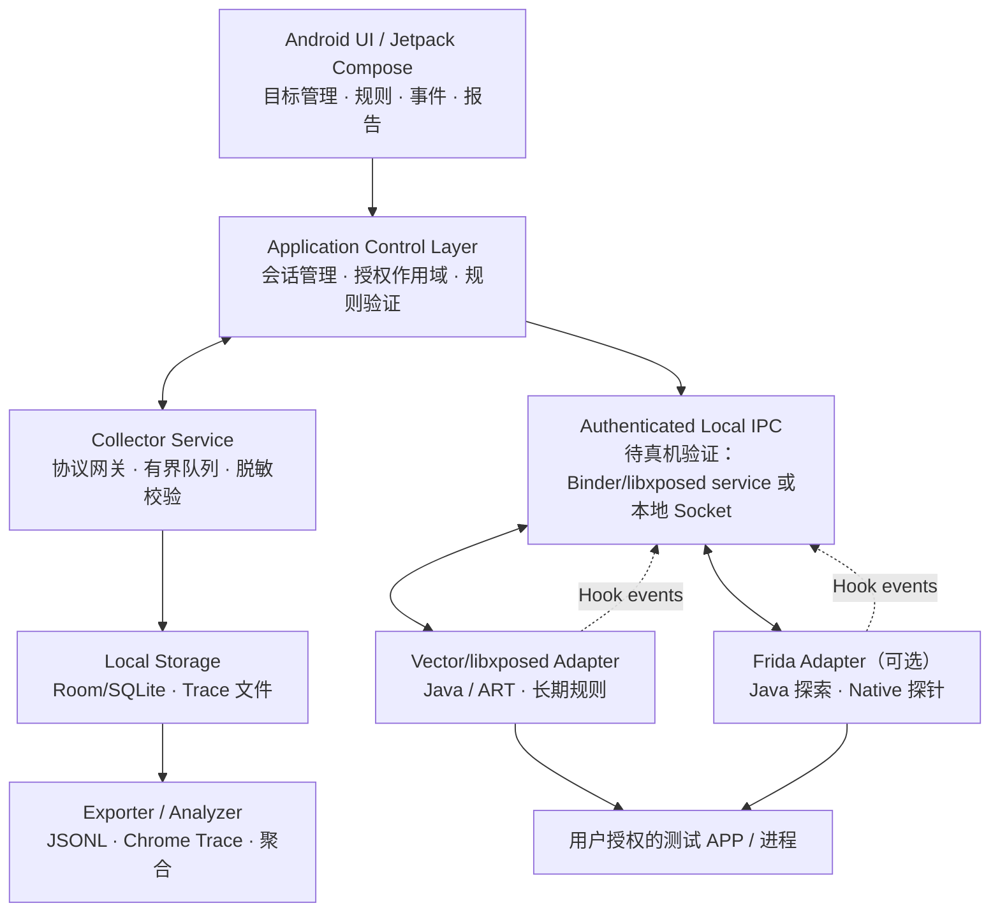
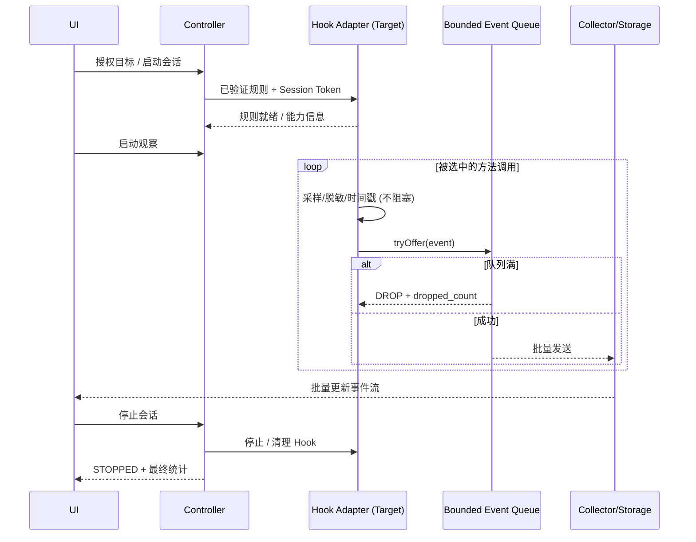
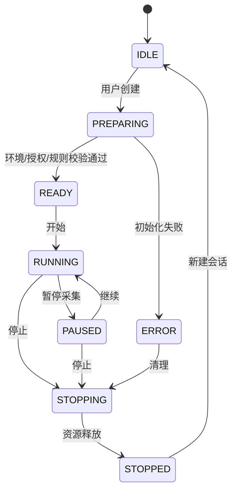

# Android Hook Lab — 软件架构设计说明书（design.md）

> 文档版本：v0.1.0（技术设计草案）  
> 日期：2026-10-19  
> 对应需求基线：[spec.md](./spec.md)  
> 首个验证平台：realme GT Neo 闪速版 RMX3350 / Android 13 / arm64 / Magisk Root / Vector。  
> 状态：架构定义完成，接口细节与兼容性需要原型验证。

## 1. 设计目标与架构约束

Android Hook Lab 以**可观测、可控、可恢复**为核心，而非追求“无限制 Hook 任意函数”。设计需要同时满足：

- 用户授权目标及显式作用域（包、进程、类、方法）；默认**只读元数据采集**。
- **观察面（Data Plane）** 与 **控制面（Control Plane）** 分离：任何 UI 渲染/数据库/网络操作不得进入目标方法的同步执行路径。
- **多引擎统一模型**：Vector/libxposed 负责常驻 Java/ART Hook；Frida 用于会话期探索，后续扩展 Native。
- Android 13 优先验证，不依赖某个固定 ROM 的私有类名；不把 Vector 的 API 兼容性等同于目标 App 的 Hook 成功率。
- 禁止注入与核心功能无关的系统关键进程；发生异常时优先停用 Hook，保障手机可恢复。
- 不复制或改写目标 APK；不包含获取他人私密数据或规避安全机制的能力。

## 2. 分层总体架构



**图示为逻辑关系而非已实现的系统通路**。尤其是 Xposed 模块与 App 控制面分属不同 UID/进程，必须通过真机验证可用且可信的 IPC，不能假设直接访问另一 App 的私有文件。

### 2.1 层次职责

| 层 | 组件 | 职责 | 不负责 |
|---|---|---|---|
| 交互层 | `apps/android` | UI、目标/会话/规则管理、可视化 | Hook 执行、Root Shell 托管 |
| 控制层 | `core/session`, `core/rules` | 状态机、授权作用域、规则校验、失败恢复 | 在 Hook 回调里做磁盘 IO |
| 引擎层 | `engines/vector` | Vector/libxposed 生命周期适配、Java 方法 Hook | 直接写数据库、绘制 UI |
| 引擎层 | `engines/frida` | Frida attach/spawn 控制、Java/Native 探针 | 常驻全局扫描 |
| 采集层 | `runtime/collector` | IPC、消息校验、限流、队列、会话数据流 | 执行任意外部脚本/命令 |
| 数据层 | `libs/protocol`, `libs/storage` | 事件模型、存储、索引、导出 | 理解具体 Hook 框架细节 |
| 分析层 | `libs/analysis`, `tools/desktop` | 聚合统计、时间线、Trace 分析 | 注入系统进程 |
| 验证层 | `samples/demo-app`, `tests` | 可重复用例、性能回归、兼容性矩阵 | 依赖真实第三方用户数据 |

依赖方向单向：UI → domain/usecase → interfaces ← engines/IPC/storage；核心数据契约不可反向依赖 Android Activity 或具体 Hook API。

## 3. 技术栈与版本策略

| 维度 | 初始方案 | 备注 |
|---|---|---|
| 最先验证设备 | RMX3350 / Android 13 / arm64 | 唯一首验组合；不宣称其他 ROM 已支持 |
| Android UI | Kotlin + Jetpack Compose + Material 3 | 开发便捷，UI 与 Hook 引擎拆分 |
| Android SDK | `compileSdk` 取稳定可用版本；`minSdk` 初拟 29 | 目标 Android 13 (API 33)；真实支持取决于引擎 |
| 异步 | Kotlin Coroutines + Flow | 所有事件异步收集，禁止主线程解析高频事件 |
| DI | 构造注入 + 接口，先不引入重量依赖 | 可替换测试实现 |
| Xposed | Vector 的 **modern libxposed** 接口优先 | 编译 API 与设备上 Vector 兼容版本必须实测并固定 |
| Frida | Frida host + JS agent，Native 可用后启用 | 作为可选组件，非 MVP 前置依赖 |
| 原生组件 | C++17 / Android NDK（按需） | 只用于高频采集/符号处理/Native Agent |
| 序列化 | 第一版明确 JSONL / JSON Schema；高频阶段可选 Protobuf | 协议 version 字段强制 |
| 存储 | Room / SQLite（元数据）+ 分段事件文件 | 避免逐事件小事务写库 |
| 构建 | Gradle Kotlin DSL + Android Gradle Plugin | 版本由首次可重复构建时锁定 |
| 测试 | JUnit + Android instrumented tests + Demo benchmarking | P50/P95/P99 使用重复试验 |

**API 依据**：Vector 支持 legacy Xposed 与 modern libxposed；modern 模块入口通常使用 `META-INF/xposed/java_init.list`、`scope.list` 等资源并继承 `XposedModule`。不同 Vector 修订版的依赖要与 upstream 实际兼容提交对齐，不预先锁死未经测试的版本。

## 4. 工程目录规划

```text
Android-Hook-Lab/
├── README.md                   # 项目导览
├── spec.md                     # 需求规格
├── design.md                   # 设计说明
├── apps/
│   └── android/                # Android UI / Android App 打包入口
├── core/
│   ├── domain/                 # 模型、会话、规则、授权作用域
│   └── usecase/                # 命令、查询、业务编排
├── engines/
│   ├── vector/                 # Vector / libxposed 适配器
│   └── frida/                  # Frida Agent 与 host 编排
├── runtime/
│   └── collector/              # 本机受限 Collector 与 IPC
├── libs/
│   ├── protocol/               # 规则、命令、事件 Schema
│   ├── storage/                # SQLite / JSONL / 清理
│   └── analysis/               # 聚合分析、树和时间线
├── tools/
│   └── desktop/                # 可选桌面 Trace Viewer
├── samples/
│   └── demo-app/               # 可控演示 App
├── tests/                      # 单元、集成和真机回归
└── docs/
    └── decisions/              # ADR 架构决策记录
```

Git 无法保存空目录；首批目录用 `.gitkeep` 占位。**目录只用于规划，不代表代码已经实现。**

### 4.1 Xposed 模块包装决策

优先采用**一个 Android APK 同时提供可视化管理 UI 和 Xposed 模块入口**，`engines/vector` 作为内部 Gradle library，被 `apps/android` 打包引用。发布产物不能无意安装两个相同包名 APK。

- 模块入口配置示意：`src/main/resources/META-INF/xposed/java_init.list`。
- 默认 Scope 只允许 Demo App；额外目标需用户手动授权并在 Vector 中设置范围。
- 规则集持久化不依赖被 Hook 应用私有文件；明确采用服务通信或受控配置分发。
- 热插拔能力逐项检测；框架不支持解绑时，UI 要明确提示“下次启动进程生效”而不是假装即时取消。

## 5. 核心数据模型

### 5.1 对象

- `TargetApp`：包名、显示名称、UID、主进程/子进程、版本和授权状态。
- `Session`：UUID、创建时间、生命周期状态、目标、Engine、采集政策及采样统计。
- `HookRule`：规则 ID、目标类/方法/签名、匹配条件、采集阶段、采样率、优先级、敏感数据政策。
- `HookEvent`：调用开始/结束/异常/控制消息，包含关联 ID 与局部单调时钟。
- `CapturePolicy`：敏感字段过滤、保留长度、堆栈深度、事件预算、存储配额。
- `Capability`：引擎支持的操作、限制原因及运行时兼容性报告。
- `EngineHealth`：连接状态、版本、崩溃次数、掉样计数、最近错误码。

### 5.2 事件契约（schema v1 示意）

```json
{
  "schema_version": 1,
  "kind": "METHOD_EXIT",
  "session_id": "2f62f56e-282a-4b54-b1a5-4d67d34598e1",
  "event_id": "a627ae4d-34b6-42ae-82ae-3b3c13c07542",
  "call_id": "c-4208",
  "parent_call_id": "c-4207",
  "engine": "VECTOR",
  "package_name": "org.example.hooklab.demo",
  "pid": 18024,
  "tid": 18058,
  "monotonic_time_ns": 4295010911000,
  "method": {
    "class_name": "org.example.demo.ImageProcessor",
    "name": "adjustBrightness",
    "signature": "(FI)F"
  },
  "duration_ns": 320000,
  "args": [{"type": "float", "safe_value": 1.25}],
  "result": {"type": "float", "safe_value": 0.85},
  "policy": "SAFE_SUMMARY",
  "truncated": false
}
```

规范要求：

1. `schema_version`、`session_id`、`kind`、`pid`、`tid`、`monotonic_time_ns` 必填；`args/result` 可缺省。
2. `monotonic_time_ns` 使用目标进程相同语义的单调时钟；不得与本地壁钟混用来计算耗时。
3. `call_id` 在进程/会话域内唯一；`parent_call_id` 只在同线程确证嵌套时设置；异步传播需显式埋点。
4. 对异常情况 `kind=METHOD_EXCEPTION`，`exception` 仅允许安全类型名与脱敏摘要。
5. 各 Engine 上报的 RawEvent 先转换为本契约，再进存储；所有导出必须有 schema 元数据。
6. 默认只允许普通原始类型的明确白名单值；字符串、二进制、对象未经授权一律仅记录类型/长度。
7. 规则和事件分别独立版本化；未来升级必须有迁移/兼容测试。

### 5.3 规则契约示例

```json
{
  "schema_version": 1,
  "id": "demo-brightness",
  "target": {
    "package_name": "org.example.hooklab.demo",
    "class_name": "org.example.demo.ImageProcessor",
    "method_name": "adjustBrightness",
    "descriptor": "(FI)F"
  },
  "engine": "VECTOR",
  "phases": ["ENTER", "EXIT", "EXCEPTION"],
  "capture": "METADATA_ONLY",
  "sample_rate": 0.1,
  "max_events_per_sec": 100,
  "capture_stack": false,
  "enabled": false
}
```

规则编辑器必须在实际 attach/注册之前进行 JSON Schema 校验与目标/作用域校验，尤其禁止泛匹配所有包/所有方法的“默认全开”规则。

## 6. Hook 引擎抽象接口

以下是**设计用伪接口**，并非现有可编译代码：

```kotlin
interface HookEngine {
    val id: EngineId
    suspend fun probe(): EngineCapabilities
    suspend fun prepare(session: SessionConfig): EngineResult
    suspend fun discover(query: DiscoveryQuery): List<MethodDescriptor>
    suspend fun install(rule: HookRule): EngineResult
    suspend fun remove(ruleId: String): EngineResult
    suspend fun pause(): EngineResult
    suspend fun stop(): EngineResult
    fun events(): Flow<HookEvent>
    fun health(): Flow<EngineHealth>
}
```

### 6.1 VectorAdapter

- 模块由 Vector 在获授权目标的进程中装载，针对明确的类/签名注册 before/after Hook。
- 采用现有 modern libxposed API 和已验证的 HookBuilder/Hooker 适配；不自制 ART Trampoline。
- 负责 class loader 变化和 overload 签名识别；无法 Hook 的方法返回具名错误。
- 事件采集置于最短回调路径：记录单调时钟、线程、方法 ID 和安全摘要；写入线程本地/有界队列。
- 不调用未知业务对象的 `toString()`、不在回调中执行网络、数据库、文件 IO。
- 注册/解绑行为以框架实测能力为准，必要时显式要求重新启动目标 App。

### 6.2 FridaAdapter

- Frida 作为**用户主动开启的动态会话工具**，与常驻 Vector 独立部署。
- 支持 Java 类枚举、目标方法 Hook，以及后续针对明确 Native 导出符号使用 Interceptor。
- Agent 到主机通过 Frida 消息 API 传递**已脱敏/限量**事件；由 Adapter 标准化为 HookEvent。
- 对 Frida 服务采取本地访问控制；不得默认暴露在 `0.0.0.0`，不得提供无鉴权的远程控制入口。
- 引擎停止时移除当前脚本及规则；Frida 断开时 UI 与状态机必须显式标记断连。
- 不使用针对第三方保护机制的通用绕过脚本，也不收集账号、令牌等敏感字段。

### 6.3 双引擎仲裁

同一个方法同一会话原则上只允许一个引擎作为主采集源。若用户确实需要双引擎对照，必须标记来源并提示潜在冲突：Hook 链顺序、内联与重入处理可能不同。跨引擎调用关联属于 P2 实验能力，不能将近似关联误标为严格父子调用。

## 7. 采集 IPC、线程与背压

### 7.1 IPC 决策

优先做一个 M0 真机原型，比较以下两种路径：

1. **现代 libxposed service / Binder 通道**：如 Vector 当前版本提供可用服务和规则/文件共享 API，优先使用其可信通信能力。
2. **受限本机 IPC broker**：必要时由 Root 显式启动 Collector Broker，通过受限 Unix Domain Socket / Binder 与目标进程通信；必须确认 Android 13 SELinux 和跨 UID 权限，不能使用 world-writable socket。

IPC 选择的验收条件：不同 UID 正常通信、身份认证、低开销、不泄露到网络、进程崩溃后可恢复、有清晰生命周期。未经真机验证前，**绝不宣称已实现跨进程采集**。

### 7.2 数据流



### 7.3 队列策略

- Hook 回调只做 `tryOffer()`，无锁或短临界区；每目标进程缓冲上限初拟 8 MiB。
- 默认优先**丢弃新增事件**并累计 `dropped_count`，避免阻塞业务线程；UI 显示采样率、队列利用率和丢弃量。
- Collector 对流事件按批写入；磁盘/IPC 故障不得反压阻塞目标业务逻辑。
- UI 采用节流分页更新；复杂堆栈解析在后台 Dispatcher 中完成。
- 对重入/递归使用 thread-local 深度和 call_id 管理，设置最大嵌套深度避免死循环。
- 时间排序和统计考虑跨线程漂移、时钟基准及采样误差。

## 8. 会话与异常状态



错误码按模块划分，如 `ENV_ROOT_UNAVAILABLE`、`SCOPE_NOT_ALLOWED`、`HOOK_METHOD_NOT_FOUND`、`HOOK_ENGINE_UNAVAILABLE`、`IPC_AUTH_FAILED`、`QUEUE_BACKPRESSURE`、`STORAGE_QUOTA_EXCEEDED`、`ENGINE_DISCONNECTED`。所有外部操作返回结构化错误，不用空字符串、无意义 null 代替失败原因。

### 8.1 崩溃恢复

- 控制面保存最后运行会话标志；异常重启后**默认保持 Hook 停用**，不自动恢复全部规则。
- 提供全局“紧急停止”（会话/规则层）和启动故障恢复说明（关闭模块范围、禁用 Vector 模块）。
- 建立每规则失败次数与熔断门槛；持续崩溃时自动停用可疑规则并向用户明确告警。
- Collector 断开时所有 Agent 降级为停止采集，不能持续本地堆积隐私数据。
- 不对重要系统启动进程进行默认注入，降低 Bootloop 风险。

## 9. 性能与内存设计

### 9.1 最小路径

`target method → lightweight hook callback → sampling → safe metadata → bounded queue → authenticated IPC → batch persist → UI flow`

- 方法耗时使用单调纳秒计时，同线程函数对由 call_id 对应；考虑异常和未闭合方法调用。
- 减少分配和反射：方法描述符缓存、固定长度缓冲、最小化 string format。
- 序列化放在采集工作线程，元数据可提前映射为短 ID；避免高频对象图遍历。
- **可配置阈值**：默认 100 events/s/规则、单目标进程上限 8 MiB；过载时限流采样而不是追求全量。
- 基准测试记录方法调用频率、温控、电量、cpu、P95/P99、丢弃比例与采集模式；必须包含对照组。
- 对用户展示“Hook 可能影响应用时序”的警告；性能分析区分**原方法耗时**与**含 Hook 的观测耗时**。

## 10. 安全威胁模型

| 风险 | 控制措施 |
|---|---|
| 未授权扫描应用 | 明确 App allowlist、可见运行状态、默认不开启 Hook |
| 记录凭据/隐私内容 | METADATA_ONLY 默认；脱敏在 Agent 最前端执行；导出二次过滤 |
| Root 通道滥用 | Broker 仅提供定义好的窄命令，不允许传入任意 shell；对来源进程身份鉴权 |
| 本机端口被其他 App 访问 | 优先 Android 私有/权限保护 IPC；不用公共 TCP 监听；启用会话 token |
| Hook 引发无限递归或卡顿 | re-entrancy guard、采样、限流、熔断、异步队列 |
| 日志积累泄露 | App 私有目录、加密可选、配额与删除策略；禁止外部共享默认开启 |
| 第三方库供应链与许可 | 固定版本和 checksum、依赖审计、明确许可证分发义务 |
| 用户误将规则用于生产关键应用 | 默认只允许 Demo/自有应用；新增目标二次确认与告警 |

**权限策略**：Root 不是常态授权。各阶段只申请完成当前操作的最小权限；禁止保留通用 `su` 命令执行接口和可被外部应用直接调用的导出组件。

## 11. 测试方案

### 11.1 测试矩阵

| 维度 | 用例 |
|---|---|
| Java 语义 | 静态/实例、构造、重载、递归、同步、异常、不同类加载器 |
| 生命周期 | 冷启动、热启动、强制停止、目标重启、Hook 暂停与恢复 |
| JNI/Native | Demo JNI 导出方法、C++ 异常映射、Native 符号定位（P2） |
| 多进程 | 不同 PID/UID，线程并发、进程死亡、IPC 权限错误 |
| 性能 | 10/100/1000 events/s；抽样与零抽样对照；队列上限与掉样 |
| 隐私 | 测试敏感字段、脱敏规则、导出报告、会话删除 |
| 失效注入 | 无 Root、Vector 缺失、Frida 断连、存储不足、权限拒绝 |
| 恢复 | 全局停止、重启不复活失控会话、规则熔断后用户可恢复 |

### 11.2 MVP 验收序列（必须真机完成）

1. 在 RMX3350 上检测 Root、Zygisk、Vector、引擎 API，生成环境报告。
2. 用户授权 Demo App 并在 Vector 中正确配置 Scope。
3. 安装单方法 Hook（入口/退出/异常），读取参数**安全摘要**、返回值安全摘要与耗时。
4. 完成 30 分钟持续调用测试，并在 UI 中显示事件数量、掉样与性能统计。
5. 人为制造异常调用和高频调用，验证不阻塞业务方法。
6. 停止采集、清空数据、重启目标进程，确认 Hook 生命周期正确。
7. 导出脱敏 JSONL 并通过 Schema 校验，确保测试的虚构秘密字段无明文残留。

## 12. 构建、CI 与工程质量

- Android / Kotlin：静态检查、单元测试、Detekt/Ktlint（初版可择其一），Android Lint。
- Native / C++（启用后）：`clang-format`、`clang-tidy`、ASan/UBSan 可行的测试场景。
- Protocol：JSON Schema 校验与向后兼容测试；变更事件字段必须带 schema_version。
- CI：分阶段执行 `lint → unit-test → debug-build → artifact-check`；密钥不放仓库；验证 APK 中的 `META-INF/xposed` 入口资源。
- 发布：Debug/Release 分离，发布包通过签名验证；建立设备/ROM/引擎兼容矩阵。
- Code Review：所有 Hook 回调变更检查重入、异常、泄漏、隐私和最坏路径开销。

## 13. 技术风险与 ADR

| 编号 | 待决策事项 | 初步方向 / 阻塞点 |
|---|---|---|
| ADR-001 | modern libxposed 还是 legacy API | modern 优先，基于已安装 Vector 版本选兼容依赖 |
| ADR-002 | 跨 UID IPC 实现 | 先验证 libxposed service/Binder；不行再选受限 Broker |
| ADR-003 | 模块与 UI 打包方式 | 单 APK 优先，避免两个包的升级/Scope 不一致 |
| ADR-004 | Frida 服务运行模式 | 显式开启、仅本地、短生命周期；与 Vector 冲突需要检测 |
| ADR-005 | Hook 动态移除 | 框架不支持时改为“下次进程启动”并提示 |
| ADR-006 | 元数据协议 | JSON Schema v1，性能验证后评估 Protobuf |
| ADR-007 | Root 管理 | 最小特权 Broker，不允许匿名 Root Shell |
| ADR-008 | 开源许可证 | 审查 Vector GPLv3、libxposed 和 Frida 组件再确定 |

## 14. 开发推进顺序

1. **M0 / Spike 1**：Android 工程 + Demo App + Vector modern API “Hello Hook”；只在 Demo App 运行。
2. **M0 / Spike 2**：可认证 IPC + 异步事件采集 + 脱敏，验证 SELinux/UID 隔离。
3. **M1**：会话/规则/目标 UI、Java Hook、存储、过滤和稳定性验收。
4. **M2**：Frida Java 动态探针、调用树/统计/导出、双引擎标准化。
5. **M3**：Native/JNI、桌面 Trace Viewer、跨 ROM 兼容性和独立扩展 SDK。

此顺序禁止将 P2 功能反向变成 M1 的阻塞依赖；每个里程碑都要留下一套可以运行的版本，而不是只有 API 框架。

## 15. 参考与依赖来源

- Vector 官方仓库及架构说明：https://github.com/JingMatrix/Vector
- libxposed API：https://github.com/JingMatrix/libxposed-api
- modern Xposed API 规范：https://github.com/LSPosed/LSPosed/wiki/Develop-Xposed-Modules-Using-Modern-Xposed-API
- Frida JavaScript API、`Interceptor` 和消息传递：https://frida.re/docs/javascript-api/
- Magisk（Root / Zygisk）：https://github.com/topjohnwu/Magisk

---

**设计基线说明**：本文件所有结构图、接口和代码片段均为架构设计，不代表项目已完成实现。任何依赖框架版本、跨 UID IPC、SELinux 兼容性、动态解绑和 Native Hook 能力都以后续代码/真机测试结果为准。
